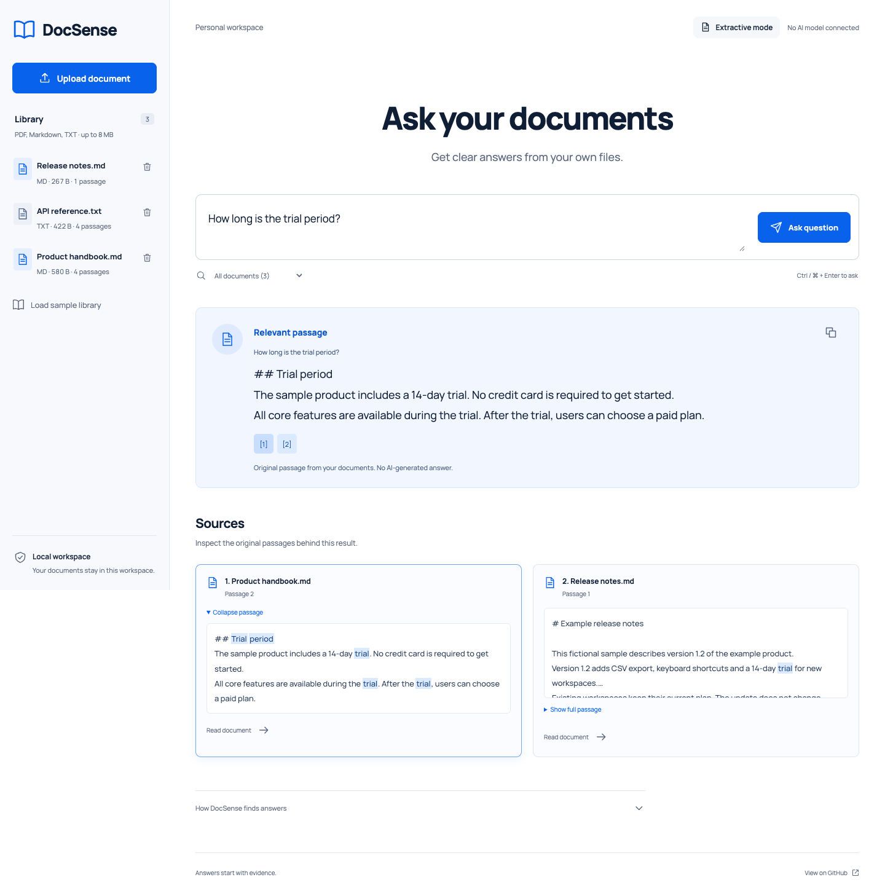
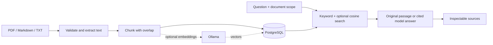

# DocSense

**Answers start with evidence.** A local document workspace built with .NET 10 and PostgreSQL/pgvector. Upload a PDF, Markdown or text file, ask a question, and inspect the original passages behind the result.

[](https://github.com/Durdona2301/docsense/actions/workflows/ci.yml)
[](LICENSE)



## What it does

- Reads text-based PDF, Markdown and UTF-8 TXT files, preserving PDF page references.
- Splits text into overlapping passages and persists the index in PostgreSQL.
- Finds relevant passages with PostgreSQL full-text search, without an account or API key.
- Optionally uses Ollama for local embeddings, pgvector cosine search and cited AI answers.
- Shows filenames, passage numbers, PDF pages and full source text for inspection.
- Supports document-scoped questions, duplicate detection, deletion and explicit reindexing.
- Includes a responsive, keyboard-accessible UI and a fictional sample library.

**Honest modes:** extractive mode shows verbatim retrieved text; generated mode uses a local model; no-evidence mode declines when retrieval finds nothing or the model reports insufficient evidence. If Ollama fails or produces invalid citation references, the app visibly falls back to original passages.

## Quick start

Install Docker with Compose, then:

```sh
git clone https://github.com/Durdona2301/docsense.git
cd docsense
git checkout docsense
docker compose up --build -d
```

Open [localhost:5076](http://localhost:5076). Choose **Load sample library**, then ask **How long is the trial period?** The example trial belongs to the fictional sample product; DocSense has no paid plan.

The first build downloads .NET and PostgreSQL images. The app and database ports bind to `127.0.0.1`. Data persists in the `postgres-data` Docker volume. `docker compose down` stops the services and retains documents. To permanently erase the workspace, explicitly run `docker compose down -v`.

Optional settings are listed in [.env.example](.env.example). Copy it to `.env` before changing ports, the local development password or model configuration. Development credentials in Compose are intentionally public and are suitable only for this loopback workspace.

### Develop with the .NET SDK

Requires .NET 10; Node is needed only for browser tests and formatting.

```sh
docker compose up -d --wait db
export ConnectionStrings__Database='Host=localhost;Port=55432;Database=docsense;Username=docsense;Password=docsense-local-dev-only'
dotnet run --project src/DocSense.Web --no-launch-profile --urls http://localhost:5076
```

If you changed the Compose database password or port, update the connection string accordingly. A missing database connection string fails startup with a setup message. Do not run the containerized web service and SDK server on the same port simultaneously.

## Enable local AI

Install [Ollama](https://docs.ollama.com/quickstart), start its service, and download the models yourself:

```sh
ollama pull embeddinggemma
ollama pull gemma3:4b
```

Models require additional disk space and RAM. The default models are examples; configurable alternatives must support the configured embedding dimensions and Ollama's JSON chat API.

For a native SDK server running beside Ollama:

```sh
export Ai__Enabled=true
export Ai__BaseUrl=http://localhost:11434
# Keep ConnectionStrings__Database from the SDK setup above.
dotnet run --project src/DocSense.Web --no-launch-profile --urls http://localhost:5076
```

For Docker Desktop, set `DOCSENSE_AI_ENABLED=true` in `.env` and recreate the web container with `docker compose up -d web`. Its default model URL is `http://host.docker.internal:11434`. If that service is not reachable from Docker (including some Linux or loopback-only Ollama configurations), run DocSense natively as above; do not expose Ollama publicly to work around it.

Documents uploaded before enabling AI remain keyword-searchable. Open each document and choose **Create embeddings**. Reindex after changing the embedding model or dimensions. Search deliberately excludes incompatible vectors instead of comparing embeddings from different model configurations.

Ollama API references: [embeddings](https://docs.ollama.com/api/embed), [chat](https://docs.ollama.com/api/chat).

## How it works



The app serves its own HTML/CSS/JavaScript, so there is no frontend build or third-party runtime CDN. Manrope is self-hosted under its [SIL Open Font License](src/DocSense.Web/wwwroot/fonts/OFL.txt). SQL is parameterized; imports are transactional; SHA-256 deduplicates files; deletion cascades to passages and vectors. A database advisory lock serializes document quota checks across processes.

The small, bounded workspace uses exact vector scans and a GIN full-text index. Approximate vector indexes and background ingestion are future work rather than unnecessary infrastructure for a personal corpus.

Paragraph and Markdown section boundaries stay intact. Long sections are split into passages up to 1,200 characters with 160-character overlap. The [small retrieval evaluation set](samples/evaluation.json) checks expected passages and out-of-scope abstention against the sample library.

## API

| Method | Route | Purpose |
| --- | --- | --- |
| GET | `/health` | Database readiness |
| GET | `/api/status` | Configured answer mode and upload limit |
| GET | `/api/documents` | List indexed documents |
| POST | `/api/documents` | Multipart upload with a `file` field |
| GET | `/api/documents/{id}/chunks` | Read indexed passages |
| DELETE | `/api/documents/{id}` | Delete a document and its index |
| POST | `/api/documents/{id}/reindex` | Create or replace embeddings |
| POST | `/api/samples` | Add the three fictional samples, idempotently |
| POST | `/api/ask` | Ask a question, optionally scoped to document IDs |

Mutations require the `X-DocSense: 1` header. This is a browser CSRF boundary, **not authentication**.

```sh
curl http://localhost:5076/api/ask \
  -H 'Content-Type: application/json' \
  -H 'X-DocSense: 1' \
  -d '{"question":"How long is the trial period?","documentIds":[]}'
```

The response includes `question`, `text`, `mode`, `sources` and an optional `notice`. Errors use Problem Details. An empty `documentIds` array searches all documents; an unknown selected ID returns 404 rather than silently expanding scope.

## Verification

```sh
dotnet restore --locked-mode
dotnet test
```

Without database configuration, the integration tests are explicitly skipped. To run them against local Compose PostgreSQL:

```sh
export DOCSENSE_TEST_DATABASE='Host=localhost;Port=55432;Database=docsense;Username=docsense;Password=docsense-local-dev-only'
dotnet test
```

Integration tests create and drop their own uniquely named database; the configured database is not cleared. The connection user needs `CREATE DATABASE` privileges.

Ollama transport, citation rejection, vector retrieval and provider outage behavior are tested with controlled HTTP responses. Running real models is a separate optional smoke test; the suite does not download model weights.

For browser tests, set `ConnectionStrings__Database` to a **disposable browser-test database**, stop any existing server on port 5076, then:

```sh
npm ci
npx playwright install chromium
npm test
npm run format:check
```

Browser tests load the sample library and add/remove a test document. They cover source inspection, document reading, question scoping, abstention, uploads, unsafe HTML rendering, error recovery and horizontal overflow at 390px. Captures are saved under `artifacts/screenshots/`. CI runs unit/integration tests, browser checks and a Docker build.

## Scope and limits

This is a **trusted, single-user local workspace**, without login or multi-user isolation. Keep its ports on loopback. Shared/public hosting requires authentication, authorization, stronger upload isolation, retention controls and operational hardening.

- Uploads: 8 MB; PDFs: 100 pages; extracted text: 500,000 characters; workspace: 200 documents.
- Scanned or image-only PDFs need external OCR. Tables and complex PDF layouts may extract imperfectly.
- Extractive mode uses keywords rather than semantic understanding; a matching word does not prove that the whole question is answerable.
- Citation validation checks reference IDs, not semantic entailment. Model answers and prompt-injection defenses are imperfect; verify claims against source text.
- No conversation memory, cloud model API, automatic model download or background indexing.
- Original uploaded files are not retained; extracted text and optional vectors are persisted. Deleting a document removes those database rows; backups and infrastructure logs have their own lifecycle.

## License

[MIT](LICENSE). Contributions and focused bug reports are welcome.
